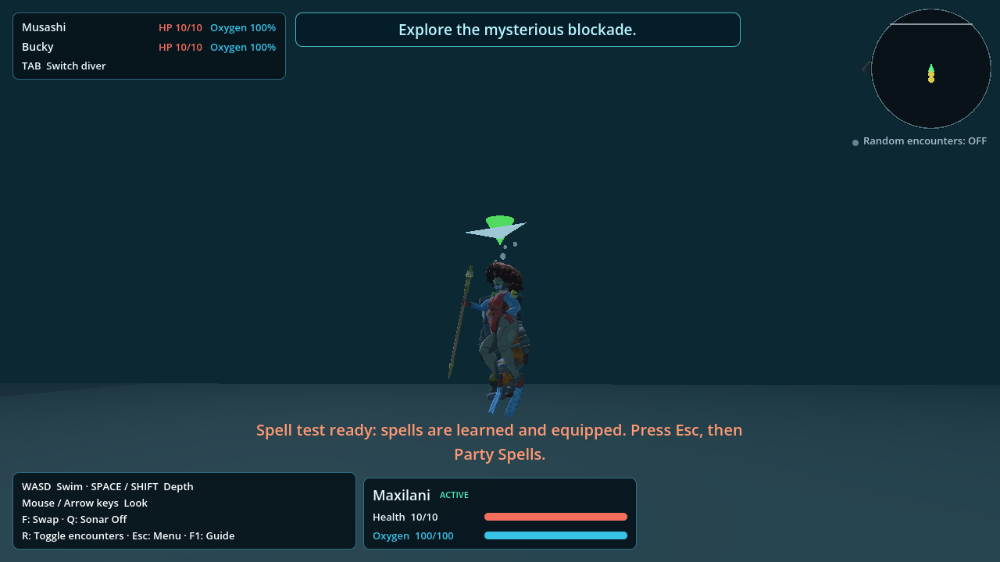
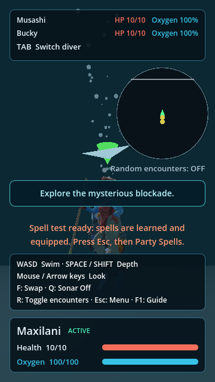
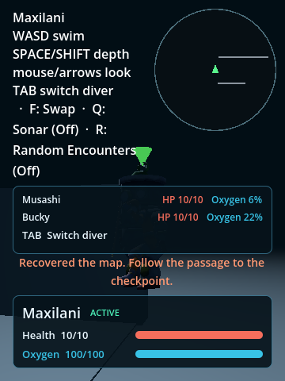
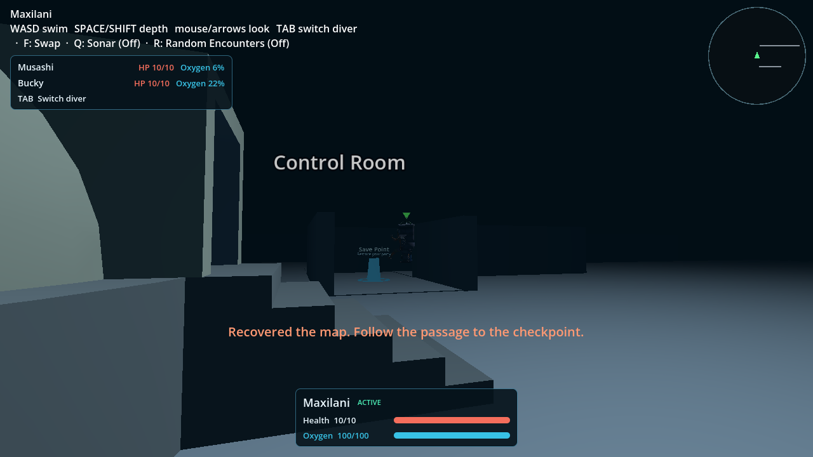

# Compact exploration HUD review

Runtime source: `67028c477382e14de9ccc53caf75b12d7e3949de`, integrating
main `2e183ccac312e20833b506fe01399a8263052146`.

[Play the preview](https://underwatergame-hi1tmcdfx-immortaldemongods-projects.vercel.app/)
or [open the immediate HUD review route](https://underwatergame-hi1tmcdfx-immortaldemongods-projects.vercel.app/?spell_playtest=1)
and select **Play Spell Test**. The existing review route skips the opening and
uses a temporary party with learned spells; it never saves. It is a presentation
fixture, not evidence of earning campaign milestones. Use TAB to change diver,
Q for Sonar, F for the current ability, R for encounters, and Esc for the menu.

The preview's [build identity](https://underwatergame-hi1tmcdfx-immortaldemongods-projects.vercel.app/build-info.json)
records the runtime source, Godot 4.7.1 and actual PCK hash:
`820f706c191bc16921a50fa8a8c918d75e264e6af00cc9b9a67d71193590db79`
(126,212,740 bytes). Downloaded hosted PCK bytes matched that hash.

## Screenshots

These are actual Godot Compatibility-renderer captures of the integrated source.
World images use the declared temporary spell-test party; maze images place
that same party at the embedded maze entrance and issue a declared notice to
test caption placement. They are not an earned campaign playthrough.






## Verification

Fresh import and final single-thread Web export completed without script or
resource errors. Rendered HUD suite: 4,646 checks passed, including generated
viewport/resource cases, real TAB/Q/R/Escape, menu/battle ownership, full-card
caption reservation and L map keeping the HUD visible. Focused maze input,
current Cordys prologue, pause presentation, and actual Run-return checks passed.

The original Chromium headless attempt reached a real battle and returned via
Run, but failed on pointer lock when pressing F. A minimal page containing only
a button and canvas reproduced the same WrongDocumentError in the same browser,
without Godot or HUD code. That run is retained as a failed observation. A
separate hosted attempt timed out on screenshot capture; it is also retained.
Neither is counted as passing browser acceptance. Final browser results are
recorded in the accompanying receipt files.

Normal desktop Firefox 158 hosted observation passed title/gameplay and actual
TAB/F/R/Escape/Q/swim checks. Grapple aim worked without the headless pointer-lock
error; no Godot script errors were observed. Developer tools opening recorded
two `file:///` security messages (also in the Vercel feedback iframe) and browser
compatibility warnings; these remain in `firefox-hosted-observation.json`, so this
is not a claim that every browser console message is clean. The hosted PCK was
downloaded independently and its SHA256 matched the exported package.

To run the OCR observer on an interactive macOS desktop:

```sh
mkdir -p output/playwright
swiftc verify/exploration_hud_ocr.swift -o output/playwright/screen-ocr
HUD_HEADED=1 node verify/exploration_hud_webcheck.mjs <export-or-url> output/playwright/web
```

Use `HUD_BROWSER=firefox` for the matching Playwright Firefox installation or
`HUD_OCR=/absolute/path/to/ocr` for another compatible OCR executable. This
observer uses a fresh profile and a declared injured-party checkpoint.

No full campaign, Windows/Linux launch or human usability acceptance is claimed.
